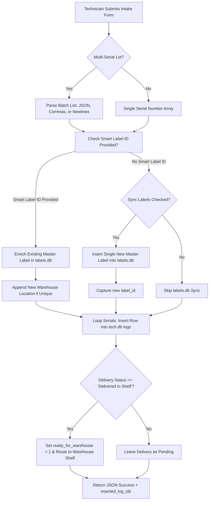

# 🧠 AI Technical Deep Dive: Technician Control Center (`/tech`)
*IQA Metal Warehouse Systems | Comprehensive Engineering Specification*

This document serves as the canonical technical reference and architectural deep dive for the `/tech` module. Future AI agents and developers should read this document to understand the underlying data structures, state machines, cross-module communication channels, and API endpoints without inspecting every file individually.

---

## 🏗️ 1. Module Architecture & Technology Stack

The `/tech` module is structured around procedural PHP 8.1+ front controllers, decoupled JSON REST endpoints, and reactive client-side JavaScript controllers.

```
📁 /tech/
├── 📄 index.php                   # Executive Technician & Admin Dashboard
├── 📄 README.md                   # Visual Module Portal & Executive Overview
├── 📁 core/
│   ├── 📄 auth.php                # RBAC Guard, session validation, force-password router
│   ├── 📄 database.php            # Connection loader -> core/Database.php, timezone init
│   └── 📄 login.php               # Standalone secure technician portal & PPP sequence auth
├── 📁 pages/
│   ├── 📄 logs.php                # Master Hardware Intake & Log Workbench
│   ├── 📄 admin_audit.php         # Admin Audit Trail & Request Approval Queue
│   ├── 📄 inventory.php           # Parts Inventory & Low Stock Alert Center
│   ├── 📄 labels.php              # Quick Thermal & ODT Label Search & Dispatch
│   └── 📄 settings.php            # Technician Profile & Security Settings
├── 📁 api/                        # 12 Specialized AJAX Endpoints (Detailed below)
├── 📁 assets/
│   └── 📁 styles/
│       ├── 📄 dashboard.css       # Daily impact widgets & global search styles
│       └── 📄 logs.css            # Intake form grid, production chips & badges
├── 📁 exports/
│   └── 📁 labels/                 # Generated .fodt Flat XML label print jobs
└── 📁 DOCS/                       # Comprehensive AI Documentation System
```

### Zero-Dependency Stack
- **Backend**: Pure Vanilla **PHP 8.1+** PDO with prepared statements.
- **Frontend**: Vanilla **JavaScript (ES6+)** with Fetch API and DOM manipulation. No frameworks (React, Vue, Alpine, jQuery) and no build tools (Node.js, npm, Vite).
- **Styling**: Vanilla **CSS3** utilizing tokens from `orders/assets/styles/components.css`.

---

## 🗄️ 2. Database Schemas & Data Models

The `/tech` module interacts with three distinct SQLite databases safely stored in `data/db/` outside the web root:
1. **`tech.db`**: Primary module database holding logs, component inventory, and daily rate limit counters.
2. **`labels.db`**: Shared product catalog (`items` table) used by the Smart Spec Collision Resolver.
3. **`users.db`**: System-wide authentication registry (`users`, `login_attempts`, `audit_log`).
4. **`warehouse.db`**: Physical inventory mapping (`locations`, `inventory`) for shelf delivery hand-offs.

### 2.1 Table: `logs` (`tech.db`)
Stores every tested hardware unit intake record.
```sql
CREATE TABLE logs (
    id INTEGER PRIMARY KEY AUTOINCREMENT,
    tech_id TEXT NOT NULL,                     -- Technician username (e.g., 'Miguel', 'Allen', 'admin')
    status TEXT NOT NULL,                      -- Functional outcome: 'Good' or 'Bad'
    qty INTEGER DEFAULT 1,                     -- Unit count (always 1 for serialized items)
    make TEXT,                                 -- Manufacturer brand (e.g., 'Dell', 'HP', 'Lenovo')
    model TEXT,                                -- Model name (e.g., 'Latitude', 'EliteBook', 'ThinkPad')
    series TEXT,                               -- Model series/number (e.g., '5400', '840 G6', 'T480')
    serial_number TEXT DEFAULT '',             -- Device unique Hardware Serial / Service Tag
    batch_number TEXT DEFAULT '',              -- Ingest Lot Number (e.g., 'LOT-1022-832')
    label_id INTEGER DEFAULT NULL,             -- Foreign Key -> labels.db (items.id) if linked
    delivery_status TEXT DEFAULT 'Pending',    -- 'Pending', 'Delivered to Shelf', 'Delivered to Order'
    delivery_destination TEXT DEFAULT '',      -- Warehouse shelf location code or Customer Order ID
    ready_for_warehouse INTEGER DEFAULT 0,     -- Flag: 1 if physically handed over to warehouse shelf
    location TEXT DEFAULT '',                  -- Warehouse shelf location code (e.g., 'A1-S2')
    
    -- Technical Hardware Specifications
    cpu TEXT,                                  -- Composite CPU string (e.g., 'i5-8350U 1.70GHz')
    cpu_gen TEXT DEFAULT '',                   -- Extracted Gen (e.g., '8th Gen', 'Apple M1')
    cpu_specs TEXT DEFAULT '',                 -- CPU Model identifier (e.g., 'i5-8350U')
    cpu_cores TEXT DEFAULT '',                 -- Physical core count (e.g., '4', '8')
    cpu_speed TEXT DEFAULT '',                 -- Clock speed in GHz (e.g., '1.70')
    gpu TEXT,                                  -- GPU chipset (e.g., 'Intel UHD 620', 'NVIDIA GTX 1650')
    ram TEXT,                                  -- Memory capacity (e.g., '16 GB', '8 GB', 'No RAM')
    storage TEXT,                              -- Storage drive (e.g., '256 GB SSD', 'No SSD')
    battery TEXT,                              -- Battery condition: 'Included / Good', 'Missing / Dead'
    battery_specs TEXT DEFAULT '',             -- Battery health % or chemistry (e.g., '88% Health, 42Wh')
    screen_res TEXT DEFAULT '',                -- Display resolution (e.g., '1920x1080 FHD', 'Touch')
    cosmetic_grade TEXT DEFAULT '',            -- Physical condition grade (e.g., 'Grade A', 'Grade B')
    bios_state TEXT,                           -- BIOS password state: 'Unlocked', 'Locked', 'Unknown'
    os TEXT,                                   -- Installed Operating System (e.g., 'Win 11 Pro', 'None')
    notes TEXT,                                -- Technician inspection or diagnostic notes
    
    -- Governance & Request State
    edited INTEGER DEFAULT 0,                  -- Flag: 1 if modified after initial intake
    delete_requested INTEGER DEFAULT 0,        -- 0: Normal, 1: Pending Admin Delete, 2: Rejected
    status_change_requested TEXT DEFAULT '',   -- Holds target status (e.g., 'Bad') pending admin approval
    created_at DATETIME DEFAULT CURRENT_TIMESTAMP -- Ingest timestamp in UTC
);
```

### 2.2 Table: `parts_inventory` (`tech.db`)
Warehouse component inventory for bench repairs and upgrades.
```sql
CREATE TABLE parts_inventory (
    id INTEGER PRIMARY KEY AUTOINCREMENT,
    part_name TEXT NOT NULL,                   -- Component description (e.g., 'DDR4 8GB 2400MHz SODIMM')
    category TEXT,                             -- 'RAM', 'Storage', 'Battery', 'Screen', 'Tool', 'Other'
    quantity INTEGER DEFAULT 0,                -- On-hand stock count
    low_stock_threshold INTEGER DEFAULT 5,     -- Minimum trigger point for dashboard alert banner
    notes TEXT,                                -- Supplier, compatibility, or bin location notes
    last_updated DATETIME DEFAULT CURRENT_TIMESTAMP
);
```

### 2.3 Table: `daily_status_changes` (`tech.db`)
Enforces technician status change rate limiting (Good -> Bad).
```sql
CREATE TABLE daily_status_changes (
    tech_id TEXT NOT NULL,                     -- Technician username
    change_date DATE DEFAULT (date('now', 'localtime')), -- Date string (YYYY-MM-DD) in Pacific Time
    change_count INTEGER DEFAULT 0,            -- Number of Good->Bad changes executed today
    PRIMARY KEY (tech_id, change_date)
);
```

---

## ⚡ 3. Hardware Intake & Smart Spec Collision Engine

The hardware intake engine (`tech/api/add_log.php`) implements an intelligent **"One Label Per Specs, Multiple Shelf Locations"** architecture to prevent cluttering `labels.db`:



### Key Spec Collision Rules:
1. **Deduplication**: If an identical configuration (Make, Model, CPU, RAM, Storage) already exists on a master label, the system links `label_id` to the existing master label rather than generating redundant records.
2. **Location Aggregation**: If the tested unit is placed on a different warehouse shelf (e.g., `B3-S1`) than the master label's existing locations (e.g., `A1-S2`), the engine appends the new shelf to the master label: `warehouse_location = 'A1-S2, B3-S1'`.
3. **Hardware Spec Enrichment**: If the master label was missing optional fields (e.g., `cpu_cores`, `screen_res`, `gpu`), the intake engine updates the master label in `labels.db` with the newly identified specs.

---

## 🔄 4. State Machines & Operational Workflows

### 4.1 Device Testing Status Workflow
- **`Good` -> `Bad` Transition**:
  - Operators/Technicians are strictly limited to **5 status changes per day** via `daily_status_changes`.
  - Once the 5-change limit is reached, the status change is queued for Administrator review (`status_change_requested = 'Bad'`).
  - Administrators can change statuses immediately with zero daily limits.
- **`Bad` -> `Good` Transition**:
  - Always immediate. If a technician repairs a damaged component (e.g., replaces faulty RAM), marking it `Good` executes instantaneously.

### 4.2 Deletion & Approval Workflow (Dual Control)
To prevent accidental data loss or unauthorized removals from warehouse records:
```
[Active Log Entry]
       │
       ▼ (Technician clicks 🗑️ Delete)
[Pending Delete] (delete_requested = 1)
       │
       ├──► (Admin clicks 'Approve Delete' on logs.php or admin_audit.php) ──► [PERMANENTLY DELETED]
       │
       └──► (Admin clicks 'Reject Delete' on admin_audit.php) ─────────────► [REJECTED] (delete_requested = 2)
```
- **Admin Exception**: When an authenticated Administrator clicks **`🗑️ Delete`**, the record is deleted immediately from `tech.db` without queuing.

### 4.3 Hybrid Delivery Pipeline
Tested devices are categorized by their next operational destination:
1. **`Pending`**: Device remains physically at the technician testing bench.
2. **`Delivered to Shelf`**: Device passed QA and was moved to a storage rack. Sets `ready_for_warehouse = 1` and registers `delivery_destination = location`. Ready for warehouse picking teams.
3. **`Delivered to Order`**: Device was tested specifically for an active customer order. Sets `delivery_destination = Order #` and bypasses general shelving.

---

## ⏰ 5. Timezone Standards: Pacific Standard Time (`America/Los_Angeles`)

The warehouse operates in California / Pacific Standard Time. Because SQLite stores timestamps in UTC via `CURRENT_TIMESTAMP`, strict timezone conversion is required:

### Server-Side (PHP)
- Both `tech/core/database.php` and `tech/core/auth.php` enforce:
  ```php
  date_default_timezone_set('America/Los_Angeles');
  ```
- Any stored UTC string from SQLite (`$row['created_at']`) must be formatted to Pacific Time:
  ```php
  $dt = new DateTime($row['created_at'], new DateTimeZone('UTC'));
  $dt->setTimezone(new DateTimeZone('America/Los_Angeles'));
  $pacific_time = $dt->format('g:i A');       // e.g., '3:47 PM'
  $pacific_date = $dt->format('m/d/Y');      // e.g., '10/22/2026'
  ```
- Daily metrics must bind `$today = date('Y-m-d');` rather than SQLite's ambiguous `date('now', 'localtime')`.

### Client-Side (JavaScript)
All frontend controllers (`logs.php`, `admin_audit.php`, `labels.php`) use standard Pacific Time formatters:
```javascript
function formatPacificTime(utcStr, options = { hour: 'numeric', minute: '2-digit' }) {
    if (!utcStr) return '';
    let str = String(utcStr).trim();
    if (!str.includes('Z') && !/[+-]\d{2}:?\d{2}$/.test(str)) str = str.replace(' ', 'T') + 'Z';
    const d = new Date(str);
    if (isNaN(d.getTime())) return utcStr;
    return d.toLocaleTimeString('en-US', { ...options, timeZone: 'America/Los_Angeles' });
}

function formatPacificDate(utcStr, options = { year: 'numeric', month: '2-digit', day: '2-digit' }) {
    if (!utcStr) return '';
    let str = String(utcStr).trim();
    if (!str.includes('Z') && !/[+-]\d{2}:?\d{2}$/.test(str)) str = str.replace(' ', 'T') + 'Z';
    const d = new Date(str);
    if (isNaN(d.getTime())) return utcStr;
    return d.toLocaleDateString('en-US', { ...options, timeZone: 'America/Los_Angeles' });
}
```

---

## 🖨️ 6. Thermal Label Generation Engine (`api/print_label.php`)

The label generation engine produces standard **2x1 inch** dual-page thermal labels directly in LibreOffice Flat XML format (`.fodt`):

### Label Layout Specification:
- **Dimensions**: Width: `2.0in`, Height: `1.0in`, Margins: `0.05in`.
- **Page A (Device Branding)**: Large 14pt bold brand name, model, series, and short CPU identifier.
- **Page B (Technical Specifications)**: 8.5pt technical summary: CPU with generation, RAM capacity, Storage capacity, Battery status, GPU, OS, and BIOS state.
- **Output Path**: `tech/exports/labels/label_{id}_{timestamp}.fodt`.
- **Zero-Dependency Guarantee**: The XML document is assembled via XML string composition. It requires no `ZipArchive` extensions and works seamlessly on local Windows XAMPP and Linux servers.

---

## 📡 7. Comprehensive API Endpoint Catalog

All API endpoints are located in `tech/api/` and return strict JSON payloads (`{"success": boolean, ...}`).

| Endpoint | Method | Role | Purpose & Parameters |
|---|---|---|---|
| `api/add_log.php` | `POST` | Operator/Admin | Ingests new device logs. Supports single or batch serials, smart spec resolution, and optional `labels.db` sync. |
| `api/get_logs.php` | `GET` | Operator/Admin | Fetches filtered log rows and real-time technician productivity stats for today. Params: `start_date`, `end_date`, `status`, `tech_id`, `delivery_status`, `q`. |
| `api/search_logs.php` | `GET` | Operator/Admin | Rapid search across `make`, `model`, `series`, and `serial_number`. Returns recent 100 or matching 50. |
| `api/lookup_label.php` | `GET` | Operator/Admin | Bridges with `labels.db`. Action `catalog` returns all unique master specs; action `lookup` searches specs by S/N or Model. |
| `api/request_actions.php` | `POST` | Operator/Admin | Primary action router: `edit` (update specs), `request_delete` (delete or submit deletion request), `approve_delete` (admin immediate), `toggle_status` (rate-limited Good/Bad flip). |
| `api/admin_actions.php` | `POST` | Admin Only | Administrative governance router: `approve_delete`, `reject_delete`, `approve_status_change`, `reject_status_change`, `admin_edit`, `admin_delete`, `admin_toggle_status`. |
| `api/pass_warehouse.php` | `POST` | Operator/Admin | Quick warehouse transfer: updates delivery destination and sets `ready_for_warehouse = 1`. |
| `api/print_label.php` | `POST` | Operator/Admin | Generates 2x1 Flat XML (`.fodt`) thermal labels for a specific log ID. |
| `api/get_inventory.php` | `GET` | Operator/Admin | Returns parts inventory items, low stock alerts, and summary stats. |
| `api/add_part.php` | `POST` | Operator/Admin | Inserts a new component into `parts_inventory`. |
| `api/update_part.php` | `POST` | Operator/Admin | Modifies component details or increments/decrements quantity. |
| `api/delete_part.php` | `POST` | Admin Only | Deletes a component from `parts_inventory`. |
