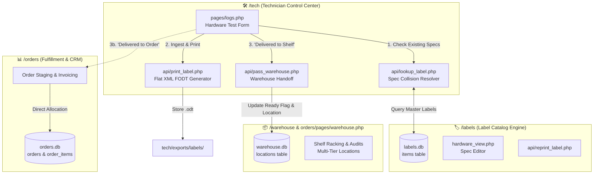

# 🔌 Cross-Module Integration Guide — Technician Control Center (`/tech`)
*Last Updated: October 2026 • Version 2.5.1 | Timezone: America/Los_Angeles (Pacific Time)*

The **Technician Control Center (`/tech`)** is designed as a modular, decoupled engine that bridges hardware intake with the physical warehouse, catalog label engine, and B2B order fulfillment pipeline.

This guide provides developers and AI agents with concrete architectural recipes, data schemas, API contracts, and integration flows to connect `/tech` with other modules in the IQA Metal Warehouse Systems ecosystem.

---

## 🗺️ Cross-Module Architecture Topology



---

## 🏷️ 1. Integration with `/labels/` (Master Catalog & Spec Engine)

### The "One Master Label per Unique Specs" Invariant
To prevent database clutter and label proliferation, `/tech` does **not** create a new label for every tested machine. Instead, it adheres to the master spec rule:
> **One Master Label per unique hardware configuration (Make + Model + CPU + RAM + Storage).** Multiple units and distinct shelf locations are consolidated under the existing master label.

### Collision Detection Workflow (`api/lookup_label.php`)
When a technician enters hardware specifications in `pages/logs.php`, the frontend fires an asynchronous debounce request to `api/lookup_label.php`:

```javascript
// Client-side spec lookup from tech/pages/logs.php
async function checkSpecCollision(specs) {
    const response = await fetch('../api/lookup_label.php', {
        method: 'POST',
        headers: { 'Content-Type': 'application/json' },
        body: JSON.stringify({
            make: specs.make,
            model: specs.model,
            cpu: specs.cpu,
            ram: specs.ram,
            storage: specs.storage
        })
    });
    const result = await response.json();
    if (result.matched) {
        // Master label found! Prompt user to link
        console.log(`Matched Master Label #${result.label_id}. Existing locations: ${result.existing_locations}`);
        return result.label_id;
    }
    return null; // Unique configuration; new label will be minted
}
```

### Consolidated Location Updating in `labels.db`
When a matched label is reused, `api/add_log.php` safely updates `labels.db` by appending the new shelf location (e.g., `'A1-S2, B3-S1'`) and incrementing the total quantity:

```php
// Server-side location consolidation in tech/api/add_log.php
$db_labels = Database::labels();

// 1. Fetch current locations and quantity
$stmt = $db_labels->prepare("SELECT location, qty FROM items WHERE id = ?");
$stmt->execute([$matched_label_id]);
$label_item = $stmt->fetch(PDO::FETCH_ASSOC);

if ($label_item) {
    $existing_locs = array_map('trim', explode(',', $label_item['location'] ?? ''));
    if (!in_array($new_shelf, $existing_locs)) {
        $existing_locs[] = $new_shelf;
        $updated_location_str = implode(', ', array_filter($existing_locs));
    } else {
        $updated_location_str = $label_item['location'];
    }

    $new_qty = ((int)$label_item['qty']) + $lot_count;

    // 2. Persist update
    $update_stmt = $db_labels->prepare("UPDATE items SET location = ?, qty = ?, updated_at = CURRENT_TIMESTAMP WHERE id = ?");
    $update_stmt->execute([$updated_location_str, $new_qty, $matched_label_id]);
}
```

---

## 📦 2. Integration with `/warehouse/` (Physical Storage & Racking)

### Handoff Protocol (`pass_warehouse.php`)
When tested hardware is physically moved from the tech testing benches to warehouse racks, `/tech` dispatches the handoff via `delivery_status`:

1. **`delivery_status = 'Delivered to Shelf'`**: Indicates the laptop is stored in warehouse bins.
2. **`ready_for_warehouse = 1`**: Signals the warehouse management module (`orders/pages/warehouse.php`) that the unit has passed all quality checks and is available for inventory audits or order picking.

### Safe Shelf Location Ensuring
Per warehouse integrity rules, when assigning a shelf code in `/tech/`, the system ensures foreign key consistency by verifying or creating the location in `warehouse.db`:

```php
// Server-side foreign key safety for shelf locations
$db_wh = Database::warehouse();

$loc_check = $db_wh->prepare("SELECT location_code FROM locations WHERE location_code = ?");
$loc_check->execute([$shelf_code]);

if (!$loc_check->fetch()) {
    // Self-healing location registration
    $loc_insert = $db_wh->prepare("
        INSERT OR IGNORE INTO locations (location_code, zone, status, created_at) 
        VALUES (?, 'Tech Intake', 'Active', CURRENT_TIMESTAMP)
    ");
    $loc_insert->execute([$shelf_code]);
}
```

### Barcode & QR Code Handheld Scanners
Warehouse pickers use rugged barcode scanners (Code128 or QR Code). The thermal labels generated by `/tech/api/print_label.php` encode:
- **Primary Barcode**: Master `label_id` (e.g. `*LB-000842*`).
- **Secondary Barcode / Text**: Serial Number and Shelf Code.
When scanned in `orders/pages/warehouse.php`, the master inventory list automatically filters to that unit.

---

## 📊 3. Integration with `/orders/` (Direct B2B Allocation)

### Fast-Track Fulfillment (`'Delivered to Order'`)
Frequently, laptops tested in `/tech` are already allocated to an active B2B wholesale order and do not need to be racked on warehouse shelves.

1. **Intake Selection**: In `tech/pages/logs.php`, the technician selects `Delivery Status: Delivered to Order`.
2. **Order Reference**: The order number or customer ID is entered into `notes` or `order_ref`.
3. **Inventory Bypass**: `ready_for_warehouse` is set to `0`, preventing warehouse pickers from redundantly binning the machine.
4. **Direct Staging**: The machine is placed directly on the outbound packing cart.

### Shared CSS & UI Design System
To maintain strict visual uniformity across the enterprise, `/tech` does **not** duplicate design tokens or basic button styles. It directly inherits:
- `../../orders/assets/styles/components.css` (Universal cards, buttons, modals, input elements)
- `../../orders/assets/styles/style.css` (Color tokens, HSL palettes, layout resets)

```html
<!-- Inside tech/pages/logs.php header -->
<link rel="stylesheet" href="../../orders/assets/styles/components.css">
<link rel="stylesheet" href="../../orders/assets/styles/style.css">
<link rel="stylesheet" href="../assets/styles/logs.css">
```

---

## 🖨️ 4. Thermal Printing Integration (`print_label.php`)

### Zero-Dependency Flat XML (`.fodt`) Standard
In strict compliance with the project's zero-dependency mandate, `/tech/api/print_label.php` generates thermal labels without `ZipArchive` or PDF libraries:
- **Format**: Flat OpenDocument Text (`.fodt`), an uncompressed, human-readable XML file.
- **Physical Size**: 2.0" x 1.0" thermal sticker stock.
- **Dual-Page Architecture**:
  - **Page 1 (Branding)**: Company logo, Make, Model, Screen Size, Cosmetic Grade.
  - **Page 2 (Specs)**: CPU, RAM, Disk Type/Capacity, Serial, Master Label ID.
- **Destination**: Output written directly to `tech/exports/labels/{filename}.odt`.
- **Windows Dispatcher**: Can be automatically triggered via `open_windows_file.php` to launch native Windows thermal print drivers (e.g., Zebra ZD410 / Rollo / DYMO).

---

## 🛠️ 5. Developer Recipes & Cross-Module Scripts

### Recipe A: External Module Checking Hardware Test History by Serial
Any external module (e.g. Inbound intake or Return RMA) can check whether a laptop was tested and its functional grade:

```php
require_once __DIR__ . '/../core/Database.php';

function getDeviceTestHistory(string $serial_number): ?array {
    $db = Database::tech();
    $stmt = $db->prepare("
        SELECT id, make, model, cpu, ram, storage, grade, status, tested_by, created_at, notes 
        FROM logs 
        WHERE serial = ? 
        ORDER BY id DESC 
        LIMIT 1
    ");
    $stmt->execute([trim($serial_number)]);
    $record = $stmt->fetch(PDO::FETCH_ASSOC);

    if (!$record) return null;

    // Convert UTC to Pacific Time
    $utc_dt = new DateTime($record['created_at'], new DateTimeZone('UTC'));
    $utc_dt->setTimezone(new DateTimeZone('America/Los_Angeles'));
    $record['tested_at_pacific'] = $utc_dt->format('Y-m-d h:i A T');

    return $record;
}
```

### Recipe B: Programmatically Requesting Thermal Label Reprint
To trigger a reprint of a label from an external controller:

```php
$payload = [
    'log_id' => 142,
    'copies' => 1
];

$ch = curl_init('http://localhost/app/tech/api/print_label.php');
curl_setopt($ch, CURLOPT_RETURNTRANSFER, true);
curl_setopt($ch, CURLOPT_POST, true);
curl_setopt($ch, CURLOPT_POSTFIELDS, json_encode($payload));
curl_setopt($ch, CURLOPT_HTTPHEADER, ['Content-Type: application/json']);
$response = curl_exec($ch);
curl_close($ch);
```

### Recipe C: Multi-Database Cross Join (Tech Logs + Orders + Master Labels)
Using SQLite cross-database attachment via PDO:

```php
$db = Database::tech();
// Attach external databases
$db->exec("ATTACH DATABASE 'C:/xampp/htdocs/app/data/db/labels.db' AS lbl");
$db->exec("ATTACH DATABASE 'C:/xampp/htdocs/app/data/db/orders.db' AS ord");

$sql = "
    SELECT 
        l.id AS log_id,
        l.serial,
        l.make,
        l.model,
        l.status,
        m.label_id,
        m.location AS shelf_locations
    FROM logs l
    LEFT JOIN lbl.items m ON l.label_id = m.id
    WHERE l.status = 'Good'
    ORDER BY l.id DESC
    LIMIT 50
";

$stmt = $db->query($sql);
$rows = $stmt->fetchAll(PDO::FETCH_ASSOC);
```

---

## 🗄️ 5. Integration with Storage & Donor Matching (`pages/storage.php`)

### Real-Time Bench Donor Match Protocol (`storage_donor_match.js` -> `api/get_storage.php`)
When a bench technician is entering a laptop in `pages/logs.php` and flags a broken screen or dead battery:
1. `TechWorkbench.DonorMatch` debounces the model field (`#intake_model_num` or `#intake_series`).
2. Dispatches an async request to `../api/get_storage.php?donor_model={encoded_model}`.
3. If matching storage units with working donor parts exist, renders an interactive alert badge above the form:
   ```html
   <div class="donor-alert-pill">⚡ Donor Match in Storage: DL-05 has a Good Screen!</div>
   ```

### Promotion Bridge (`api/promote_storage.php` -> `logs`)
When a missing-part unit in Storage is repaired using donor parts or freshly delivered components:
1. Technician clicks **`Promote to Good`** on the Storage Workbench.
2. `api/promote_storage.php` updates `storage_units.status = 'Promoted to Good'`.
3. An atomic transaction inserts a new entry into `logs` (`tech.db`) with `status = 'Good'` and `delivery_status = 'Pending'`, allowing the promoted machine to immediately enter the warehouse shelving and thermal labeling workflow.
