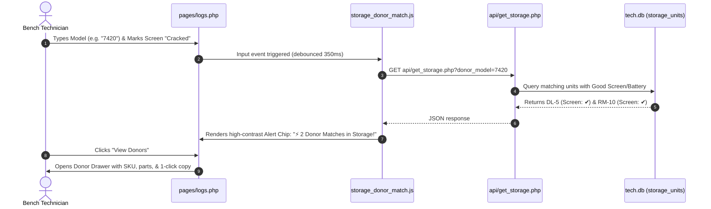

# 🗄️ Storage & Donor Hub — Engineering & AI Agent Documentation (`/tech`)
*IQA Metal Warehouse Systems | Comprehensive Subsystem Specification*

---

## 🎯 1. Domain Purpose & Architecture

The **Storage & Donor Hub** (`/tech/pages/storage.php`) is a mission-critical workstation module within the Technician Control Center. It manages units that cannot be immediately routed to sale or warehouse stock (`Good`) and are not discarded (`Bad`):

1. **Incomplete / Missing Part Units**: Machines waiting for a replacement screen, battery, SSD, or BIOS unlock before they can pass quality control.
2. **Donor Machines**: Units with dead motherboards or severe physical damage that contain functional, high-value components (`Good Screen`, `Good Battery`, `Good Keyboard/Palmrest`, `Good RAM/SSD`).
3. **Cross-Module Donor Matching**: As technicians test incoming machines in Hardware Logs (`pages/logs.php`), the system performs real-time queries against storage inventory. If a matching model with a working screen or battery exists in Storage, technicians receive an immediate visual alert with 1-click access to the donor SKU.

```
📁 tech/
├── 📄 pages/storage.php             # Master Touch-First Storage Workbench
├── 📁 assets/
│   ├── 📁 styles/storage.css        # Touch-First Styles (≥48px targets)
│   └── 📁 js/modules/
│       ├── 📄 storage_workbench.js   # Master Storage Controller & Table Engine
│       └── 📄 storage_donor_match.js # Cross-Module Donor Alert Subsystem
├── 📁 api/
│   ├── 📄 get_storage.php           # Filtered Query & Donor Search JSON
│   ├── 📄 add_storage.php           # Ingest Storage Unit (auto SKU generation)
│   ├── 📄 update_storage.php        # Update components & harvest donor parts
│   └── 📄 promote_storage.php       # Promote unit to Good -> Hardware Logs
└── 📁 DOCS/
    └── 📄 STORAGE_MODULE.md         # This Canonical Documentation
```

---

## 🗄️ 2. Database Schema (`storage_units` in `data/db/tech.db`)

The subsystem operates on a dedicated SQLite table inside `tech.db` maintaining full WAL mode and foreign-key isolation:

```sql
CREATE TABLE IF NOT EXISTS storage_units (
    id INTEGER PRIMARY KEY AUTOINCREMENT,
    sku TEXT UNIQUE NOT NULL,                  -- Internal SKU: 'RM-1', 'DL-5', 'DP-12', 'AP-4'
    date_added DATE NOT NULL,                  -- Pacific Time (YYYY-MM-DD)
    brand TEXT NOT NULL,                       -- 'Dell', 'HP', 'Lenovo', 'Apple', 'Microsoft'
    model_num TEXT NOT NULL,                   -- Specific model: '7420', '650 G10', 'A2179', 'T480'
    series TEXT DEFAULT '',                    -- 'Latitude', 'EliteBook', 'ThinkPad'
    battery TEXT DEFAULT '',                   -- Condition: 'Good', 'No Bat', 'Bad BAT', 'Harvested / Taken'
    screen TEXT DEFAULT '',                    -- Condition: 'Good Screen', 'Bad Screen', 'Cracked', 'Harvested / Taken'
    issue TEXT DEFAULT '',                     -- Defect: 'No Power', 'BIOs Lock', 'MB Bad'
    need TEXT DEFAULT '',                      -- Needed component: 'Screen', 'Battery', 'SSD', 'Back Plate'
    notes TEXT DEFAULT '',                     -- Inspection remarks & harvest audit trails
    status TEXT DEFAULT 'In Storage',          -- 'In Storage', 'Promoted to Good', 'Harvested / Scrapped'
    tech_id TEXT DEFAULT 'tech',               -- Technician username
    created_at DATETIME DEFAULT CURRENT_TIMESTAMP
);

CREATE INDEX IF NOT EXISTS idx_storage_sku ON storage_units(sku);
CREATE INDEX IF NOT EXISTS idx_storage_brand_model ON storage_units(brand, model_num);
CREATE INDEX IF NOT EXISTS idx_storage_status ON storage_units(status);
CREATE INDEX IF NOT EXISTS idx_storage_date ON storage_units(date_added DESC);
```

### SKU Prefix Conventions
* **`RM-xx`**: Repair Machine / General Missing 1 Part (from historical intake).
* **`DL-xx`**: Dell Latitude
* **`DP-xx`**: Dell Precision
* **`DeX-xx`**: Dell XPS
* **`HE-xx`**: HP EliteBook
* **`HZ-xx`**: HP ZBook
* **`HpPro-xx`**: HP ProBook
* **`LT-xx`**: Lenovo ThinkPad
* **`LO-xx`**: Lenovo Other (Yoga, IdeaPad)
* **`AP-xx`**: Apple MacBook / Air / Pro
* **`MS-xx`**: Microsoft Surface

---

## ⚡ 3. API Catalog

### 3.1 `GET tech/api/get_storage.php`
Fetches filtered storage inventory and aggregated summary statistics.
* **Query Parameters**:
  * `status`: Filter by status (`In Storage` [default], `all`, `Promoted to Good`, `Harvested / Scrapped`).
  * `brand`: Brand filter (`Dell`, `HP`, `Lenovo`, `Apple`, etc.).
  * `need`: Component need (`Screen`, `Battery`, `SSD`).
  * `search`: Freeform substring search across SKU, model, issue, need, notes.
  * `donor_model`: Target device string (e.g. `Latitude 7420`). Tokenizes words and matches against `model_num` or `series`.
  * `donor_part`: Filter by donor component viability (`screen`, `battery`, or `any`).
* **Response Contract**:
  ```json
  {
    "success": true,
    "count": 127,
    "stats": {
      "total_in_storage": "127",
      "needs_screen": "16",
      "needs_battery": "30",
      "donors_good_screen": "106",
      "donors_good_battery": "52",
      "promoted_count": "1",
      "harvested_count": "0"
    },
    "data": [ ... ]
  }
  ```

### 3.2 `POST tech/api/add_storage.php`
Ingests a new unit into storage with automated SKU generation if omitted.
* **Payload**: `brand`, `model_num`, `series`, `battery`, `screen`, `issue`, `need`, `notes`, `sku` (optional).
* **Behavior**: If `sku` is omitted, detects the brand/series prefix, finds the maximum numeric suffix, and assigns the next sequential SKU.

### 3.3 `POST tech/api/update_storage.php`
Updates unit details or executes a donor harvest.
* **Payload (Edit)**: `id`, `brand`, `model_num`, `series`, `battery`, `screen`, `issue`, `need`, `notes`, `status`.
* **Payload (Harvest)**: `id`, `action = 'harvest'`, `part = 'Screen'|'Battery'`, `recipient = 'Laptop #ORD-1022'`.
  * Automatically sets component condition to `Harvested / Taken`.
  * Appends structured audit log to `notes`: `[Harvested Screen for Laptop #ORD-1022 on 2026-10-27 by Miguel]`.

### 3.4 `POST tech/api/promote_storage.php`
Executes status transitions out of storage:
* **Promote to Good (`action = 'promote_to_good'`)**:
  * Takes `id`, `serial_number`, `ram`, `storage`, `cpu`, `resolution_notes`.
  * Inserts a new record into `logs` (`tech.db`) with `status = 'Good'` and `delivery_status = 'Pending'`.
  * Updates `storage_units.status = 'Promoted to Good'` with cross-reference log ID.
* **Retire Scrapped (`action = 'retire_scrapped'`)**:
  * Updates `storage_units.status = 'Harvested / Scrapped'` with retirement reason.

---

## 🔄 4. Cross-Module Donor Matching Workflow



---

## 🔒 5. Invariants & Token Optimization Rules for Future AI Agents

1. **Do NOT Re-Architect Hardware Logs**:
   - `pages/logs.php` already handles `Good` and `Bad` intake. Do not dismantle the existing intake workflow or labels synchronization.
2. **Strict Pacific Time Boundaries**:
   - Storage intake dates evaluate against `date('Y-m-d')` in `America/Los_Angeles`.
3. **Prepared Statements**:
   - All dynamic SQL statements in `get_storage.php`, `add_storage.php`, `update_storage.php`, and `promote_storage.php` MUST use PDO prepared statements.
4. **Touch-First UI (≥48px)**:
   - All interactive controls, inputs, and action buttons in `pages/storage.php` and `storage.css` must maintain a minimum touch target of 48px height.
5. **Regression Verification**:
   - Always run `C:\xampp\php\php.exe tests/run.php` after modifying storage schemas or endpoints. All 46 tests must pass.
