# 🛠️ Technician Control Center (`/tech`)
*IQA Metal Warehouse Systems | Architecture & Documentation Hub*

Welcome to the **Technician Control Center (`/tech`)**, the mission-critical hardware testing, diagnostic logging, and inventory triage station for IQA Metal Warehouse Systems. 

This module serves as the primary workbench for warehouse bench technicians, providing high-speed testing logs, automated master label spec consolidation, dual-page thermal label printing, parts inventory tracking, incomplete unit storage triage, smart donor part matching, and warehouse shelf routing.

---

## 🧭 Documentation System Index

For detailed architectural specifications, rules, and integration protocols, consult the dedicated documentation suite in [`tech/DOCS/`](file:///c:/xampp/htdocs/app/tech/DOCS/):

| Documentation Guide | Primary Audience | Key Topics Covered |
| :--- | :--- | :--- |
| 🤖 [AI_AGENT_INSTRUCTIONS.md](file:///c:/xampp/htdocs/app/tech/DOCS/AI_AGENT_INSTRUCTIONS.md) | AI Agents & Engineers | Non-negotiable core rules, zero-dependency policy, Pacific Time invariant, RBAC guidelines, and anti-patterns. |
| 🔬 [AI_TECHNICAL_DEEP_DIVE.md](file:///c:/xampp/htdocs/app/tech/DOCS/AI_TECHNICAL_DEEP_DIVE.md) | Core Maintainers & Architects | Database schemas (`logs`, `storage_units`, `parts_inventory`), Smart Spec Collision Engine, state machines, and 16-endpoint API catalog. |
| 🗺️ [MODULE_SITEMAP.md](file:///c:/xampp/htdocs/app/tech/DOCS/MODULE_SITEMAP.md) | Developers & Auditing | Exhaustive inventory of every file, endpoint, stylesheet, route parameter, and dependency graph. |
| 🔌 [CROSS_MODULE_INTEGRATION_GUIDE.md](file:///c:/xampp/htdocs/app/tech/DOCS/CROSS_MODULE_INTEGRATION_GUIDE.md) | External Integrators & Agents | Direct protocols for connecting `/tech` to `/labels/`, `/warehouse/`, `/orders/`, and thermal barcode scanners. |
| 🗺️ [roadmap.md](file:///c:/xampp/htdocs/app/tech/roadmap.md) | Engineers & Technicians | Planned implementation blueprint for anti-duplicate submission locks and visual loading states. |
| 📦 [STORAGE_ROADMAP.md](file:///c:/xampp/htdocs/app/tech/STORAGE_ROADMAP.md) | Engineers & Technicians | 6-phase completed implementation blueprint for the Storage & Donor Matching subsystem. |
| 🗄️ [STORAGE_MODULE.md](file:///c:/xampp/htdocs/app/tech/DOCS/STORAGE_MODULE.md) | Engineers & AI Agents | Comprehensive architecture, schemas, API catalog, and donor matching guide. |

---

## 🏗️ System Architecture & Data Flow

```mermaid
graph TD
    subgraph Frontend Interfaces ["📱 Touch-First Workbench Views"]
        DASH["index.php<br/>KPI Yields & Velocity"]
        LOGS["pages/logs.php<br/>Master Testing Workbench"]
        STORAGE["pages/storage.php<br/>Storage & Donor Workbench"]
        PRT_STR["pages/print_storage_label.php<br/>Thermal Barcode Label Station"]
        AUDIT["pages/admin_audit.php<br/>Admin Quality Ledger"]
        INV["pages/inventory.php<br/>Component Parts Inventory"]
        LBL["pages/labels.php<br/>Label Reprint Station"]
    end

    subgraph Core APIs ["⚡ Zero-Dependency REST Endpoints"]
        ADD["api/add_log.php"]
        LOOKUP["api/lookup_label.php"]
        PRINT["api/print_label.php"]
        PASS["api/pass_warehouse.php"]
        REQ["api/request_actions.php"]
        ADM["api/admin_actions.php"]
        GET_STR["api/get_storage.php"]
        ADD_STR["api/add_storage.php"]
        UPD_STR["api/update_storage.php"]
        PRO_STR["api/promote_storage.php"]
        BARCODE["core/barcode.php<br/>Code 128 Engine"]
    end

    subgraph Data Stores ["💾 SQLite Data Layer (WAL Mode)"]
        TECH_DB[("data/db/tech.db<br/>logs, storage_units, parts, daily_changes")]
        LABELS_DB[("data/db/labels.db<br/>master catalog items")]
        WH_DB[("data/db/warehouse.db<br/>locations & bins")]
        USERS_DB[("data/db/users.db<br/>users, audit_log")]
    end

    LOGS -->|Test Entry & Debounce| LOOKUP
    LOOKUP <-->|Spec Matching| LABELS_DB
    LOGS -->|Submit Batch Intake| ADD
    ADD -->|Save Records| TECH_DB
    ADD -->|Consolidate Locations & Qty| LABELS_DB
    ADD -->|Generate Thermal FODT| PRINT
    LOGS -->|'Delivered to Shelf'| PASS
    PASS -->|Update Ready Flag & Shelf| WH_DB
    LOGS -->|Delete / Status Downgrade Request| REQ
    AUDIT -->|Admin Approve / Reject| ADM
    ADM -->|Update & Audit Record| USERS_DB

    LOGS -.->|Real-Time Donor Lookup| GET_STR
    GET_STR <-->|Query Working Parts| TECH_DB
    STORAGE -->|List & Filter| GET_STR
    STORAGE -->|Ingest Unit| ADD_STR
    STORAGE -->|Harvest Part / Edit| UPD_STR
    STORAGE -->|Promote to Good| PRO_STR
    PRO_STR -->|Insert Tested Log| TECH_DB
    STORAGE -->|1-Click Print Label| PRT_STR
    PRT_STR <-->|Vector SVG Barcode| BARCODE
```

---

## ⚡ Core Operational Features

### 1. High-Speed Hardware Intake Workbench (`pages/logs.php`)
- **Dynamic Lot Ingestion**: Ingest single laptops or paste space/comma-delimited serial numbers for fast batch lots.
- **Smart Spec Collision Resolver**: Automatically queries `labels.db` as the technician fills in hardware specs. If an identical specification configuration already exists, the system prompts the technician to link the master `label_id` and appends the new shelf location, preventing duplicate label creation.
- **Touch-First Accessibility**: Form controls, cosmetic grade pills (A/B/C/D), and pass/fail buttons are strictly designed with a minimum **48x48px** touch target for warehouse touch monitors and rugged tablets.

### 2. Physical Warehouse Routing (`pass_warehouse.php`)
- **`Delivered to Shelf`**: Automatically sets `ready_for_warehouse = 1` and registers the physical shelf location in `warehouse.db`.
- **`Delivered to Order`**: Routes the machine directly to B2B outbound packaging carts, bypassing warehouse storage racks.

### 3. Dependency-Free Thermal Label Engine (`api/print_label.php`)
- Generates 2.0" x 1.0" dual-page thermal labels using **Flat XML (`.fodt`)** string interpolation without `ZipArchive` or PDF libraries.
- **Page 1 (Branding)**: Company logo, Make, Model, Screen Size, Cosmetic Grade.
- **Page 2 (Specs)**: CPU, RAM, Disk Capacity, Serial Number, and Barcode.

### 4. Dual-Control Security & RBAC Governance
- **Technicians (`Operator` / `tech`)**: Can enter tests, request deletions (`delete_requested = 1`), and change status to `Bad` (rate-limited to 5/day to prevent accidental purges).
- **Administrators (`Admin`)**: Can immediately approve deletions, reject invalid entries, execute hard purges, and review technician velocity metrics in `pages/admin_audit.php`.

### 5. Warehouse Parts Inventory (`pages/inventory.php`)
- Live component tracking for RAM (DDR3, DDR4, DDR5), Storage (2.5" SATA, M.2 NVMe, Apple SSD), Batteries, and Replacement Screens.
- Automated low-stock warning chips triggered when `stock <= min_stock`.

### 6. Storage & Donor Triage Hub (`pages/storage.php`)
- **Incomplete Units & Donor Tracking**: Dedicated workbench for machines missing 1 part (screen, battery, SSD, BIOS lock) and donor machines holding viable harvestable components.
- **⚡ Smart Cross-Module Donor Matcher**: During intake on the testing bench (`pages/logs.php`), debounced queries alert technicians in real-time if a matching unit with a good screen or battery is sitting in storage.
- **Lifecycle Status Machine**: Seamless transitions: `In Storage` → `Harvested / Scrapped` (with structured harvest audit trails) or `Promoted to Good` (migrates unit directly into `logs` as tested Good hardware ready for shelf routing).

### 7. Zero-Dependency Barcode Engine & 2"×1" Thermal Stickers (`pages/print_storage_label.php`)
- **Pure PHP Code 128 Generator (`core/barcode.php`)**: Generates vector SVG barcodes with checksum verification, readable by any 1D/2D optical or laser scanner.
- **Thermal Sticker Formats**: Calibrated for 2.0" x 1.0" rolls in two modes:
  - **SKU-Only Mode**: High-contrast, large-type SKU and tall scannable barcode for quick rack location.
  - **Detailed Mode**: SKU, Barcode, Brand, Model, Date, and Need/Issue tags.
- **Ingest Auto-Print**: 1-click ingest immediately launches the print dialog with zero manual setup.

---

## 🔒 Engineering Standards & Invariants

1. **Zero-Dependency Mandate**: Built exclusively with **Vanilla PHP 8.1+**, **Vanilla JavaScript (ES6+)**, and **Vanilla CSS3**. No Node.js build steps, no Composer packages, no external runtimes.
2. **Mandatory Pacific Timezone**: All warehouse operations run on **Pacific Time (`America/Los_Angeles`)**. Database timestamps stored in UTC must be converted before display using `DateTimeZone('America/Los_Angeles')` or client-side `formatPacificTime()`. Daily counters must evaluate boundaries against `$today = date('Y-m-d')` in Pacific Time.
3. **100% Prepared Statements**: Every SQL query with dynamic parameters uses PDO prepared statements with bound parameters (`$stmt->prepare()` / `$stmt->execute()`).
4. **Design System Inheritance**: Inherits core UI styling and components from `../../orders/assets/styles/components.css` and `../../orders/assets/styles/style.css`.

